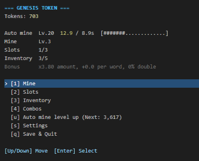
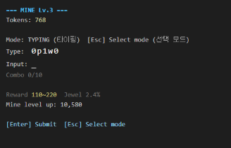

# GENESIS TOKEN

- 랜덤 문자열을 따라 치는 타자 채굴과 자동 채굴을 합친 방치형 웹 게임임.
- 업무 중 짬짬이 켜두고 키보드로만 플레이할 수 있음 (마우스도 지원함).
- 최종 목표: 업그레이드를 모두 끝내고 Genesis Token을 구매하는 것.




## 게임 구성

| 시스템 | 내용 |
|---|---|
| 타자 채굴 (Mine) | 화면 문자열을 입력해 토큰과 쥬얼 획득. 광산 레벨이 오르면 문자열이 길고 어려워짐 |
| 자동 채굴 (Auto Miner) | 일정 간격마다 토큰 자동 지급. 보조 수입 |
| 쥬얼 (Jewel) | Ruby, Topaz, Sapphire, Emerald, Diamond. 등급 Normal ~ Legendary |
| 슬롯 / 조합 | 쥬얼을 슬롯에 장착해 효과 적용. 같은 쥬얼 조합 시 추가 보너스 |
| Genesis | 최종 아이템 구매 시 엔딩, 클리어 기록 저장 |

- 플레이 시간 목표: 빠르면 약 3일, 보통 약 7일.
- 저장은 브라우저(localStorage)에 됨. 오프라인 보상은 없음.

## 실행 방법

- Node.js만 있으면 됨 (외부 패키지 없음).

```
npm start
```

- 브라우저에서 `http://localhost:3000` 접속 (포트 변경: `PORT` 환경변수).

```
npm run sim
```

- 밸런스 시뮬레이션 실행 (`tools/sim.js`).

## 폴더 구조

| 경로 | 내용 |
|---|---|
| `server.js` | 정적 파일 서버 |
| `public/` | 게임 화면과 로직 (`config.js`에 밸런스 수치 모음) |
| `tools/sim.js` | 밸런스 시뮬레이터 |
| `docs/design.md` | 전체 기획서 |
